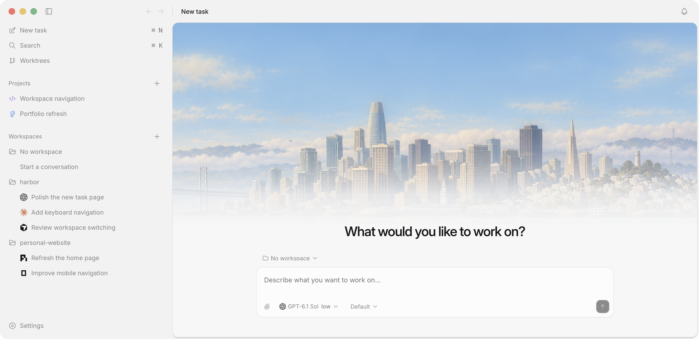
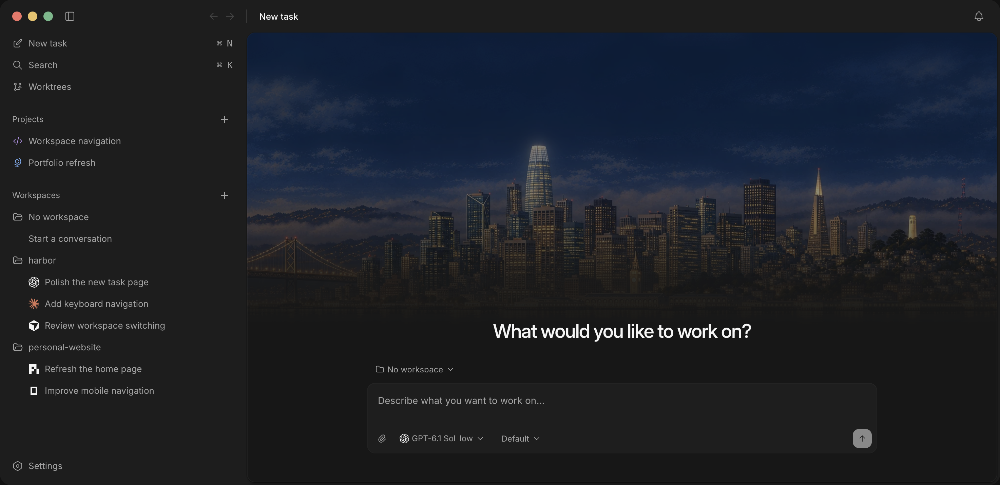

<p align="center">
  
</p>

<h1 align="center">Harbor</h1>

<p align="center"><em>an ode to personal software.</em></p>

<p align="center">
  a local desktop home for coding agents.&nbsp;<br>
  your folders, your tools, your small corner of the computer.
</p>

<p align="center">
  <a href="#get-started">get started</a> ·
  <a href="docs/getting-started.md">the guide</a> ·
  <a href="#reference">reference</a>
</p>

---

there is a particular joy in making a tool for yourself. a little script that gives you an afternoon back. a place to keep the things you care about. an app that fits the way your mind works.

some software is worth making even if only one person ever uses it.

Harbor is built in that spirit: a place to work with coding agents, follow an idea, and shape it into something you can use. it brings conversations, local folders, terminals, and code review into one desktop app, with care for the small details you live with every day.

<p align="center">
  
  
</p>

## a place for your work

- **start where you are.** open a local folder, work in a Git worktree, or begin a freeform conversation without choosing a workspace.
- **bring your agents.** use OpenAI Codex, Claude Code, and Grok Build through the Agent Client Protocol.
- **follow the thread.** move between the main conversation and its workers, review changes, and keep a terminal beside the work. pull a tab into its own window when you want more room.
- **come back to it.** conversations and archives stay on your machine. reconnect a session or restore an archived worktree when you need it again.

## get started

for local development on Apple silicon with macOS 12 or later, install Node 22+, Rust, and the Xcode command-line tools, then run:

```sh
npm ci
npm run desktop
```

install and authenticate your preferred agent separately, then configure its executable in settings. choose a folder, or leave the workspace empty, and start a conversation.

Harbor is a development release. the [setup guide](docs/getting-started.md) covers your first conversation; [provider compatibility](docs/providers.md) records tested versions and capabilities.

## reference

| read | for |
| --- | --- |
| [using Harbor](docs/getting-started.md) | setup, workspaces, worker conversations, windows, and shortcuts |
| [development](docs/development.md) | builds, local signing, visual feedback, tests, and verification limits |
| [providers](docs/providers.md) | adapters, model discovery, native handoff, and compatibility |
| [storage and recovery](docs/recovery.md) | local data, session reconnection, archives, and restoration |
| [architecture](docs/architecture.md) | execution, persistence, protocols, and extension points |
| [interface](docs/interface.md) | native surfaces, artwork provenance, and Fluid Functionalism |
| [worker verification](docs/subagent-verification.md) | live acceptance records and provider-specific evidence |

---

<p align="center"><em>for the things only you would think to make.</em></p>
